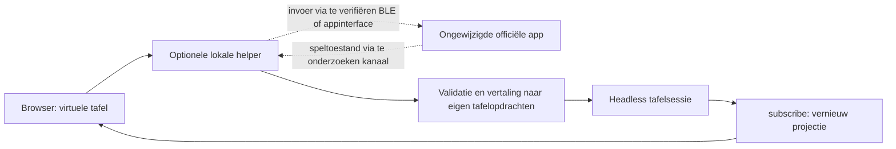

# Vooronderzoek: officiële app koppelen aan de virtuele tafel

Datum: 22 oktober 2026. Doel: een speelbare sessie met de ongewijzigde officiële Milan-app, zonder fysieke bordspelonderdelen. De app blijft de autoriteit voor regels, verhaal, dobbelsteenuitkomsten en campagne. Dit onderzoek levert een voorkeursrichting en concrete verificatiestappen; nog geen werkende koppeling.

## Advies

Onderzoek een **optionele native Windows-helper met twee afzonderlijke verbindingen**: invoer van onze tafel naar de officiële app, en speltoestand/instructies vanuit de app terug naar onze tafel. Een BLE-peripheral/GATT-route is de meest gerichte technische kandidaat voor Core-invoer. Voor automatisch plaatsen van invloed is daarnaast een bron van app-toestand nodig; daarvoor heeft een bruikbaar netwerk-/controllerkanaal de voorkeur boven beeldherkenning.

Dit is een architectuurkeuze op basis van de gevonden componenten en beschikbare Windows-API's, geen bewezen compatibele oplossing. Controleer eerst de normale appflow: als deze al bruikbare handmatige invoer biedt, is dat de kortste route. Fabrikantcontact en een SDK-aanvraag zijn geen voorwaarde voor de hier beschreven lokale verificaties.

Een BLE-verbinding alleen maakt het project nog niet speelbaar. We moeten ook sessiestart, geldige personageselectie/registratie, locatie-invoer, contactvrijgave en hervatten aantonen. Core-uitvoer hoeft geen invloedsaantallen te bevatten: die behoren tot de speltoestand van de app en moeten apart worden gevonden.

## Wat nu is vastgesteld

| Bevinding | Bewijs | Betekenis en beperking |
| --- | --- | --- |
| De app communiceert volgens de hardwaredocumentatie via BLE met de Core. | [Xplored Hardware](https://teburu.zendesk.com/hc/en-us/articles/25458765821979-Teburu-Hardware) | Een virtuele Core zou zich aan de peripheral/serverkant moeten gedragen. Het berichtcontract ontbreekt nog. |
| De Windows-installatie noemt `Teburu.dll`, `Starbox.BLE.dll`, `Starbox.Network.dll`, `Starbox.Networking.dll` en `Unity.WebRTC.dll` in `ScriptingAssemblies.json`. De native BLE- en WebRTC-DLL's zijn aanwezig. | Lokaal manifest van Windows 1.0.9, alleen gelezen; fingerprints in het private rapport. | Zowel hardware- als netwerkcommunicatie zijn serieuze onderzoekssporen. Een dependency bewijst geen openbare API of daadwerkelijk gebruik in een specifieke flow. |
| Er zijn 45 bestanden `Location_*.json` onder `StreamingAssets/MapsOffsets/Milan`. | Alleen bestandsnamen geteld en een beperkte structuurcontrole, geen configuratie gekopieerd. | Aanwijzing voor bestaande presentatieconfiguratie. Het formaat en de betekenis zijn niet gevalideerd; de nummers zijn geen bewezen sensor- of districtmapping. |
| Windows biedt GATT-server-API's en een capability-query voor peripheral-ondersteuning. | [Microsoft GATT Server](https://learn.microsoft.com/en-us/windows/apps/develop/devices-sensors/gatt-server), [BluetoothAdapter.IsPeripheralRoleSupported](https://learn.microsoft.com/en-us/uwp/api/windows.devices.bluetooth.bluetoothadapter.isperipheralrolesupported) | Native helper is technisch onderzoekbaar. De eigen adapteruitkomst en hardwarewaarnemingen blijven uitsluitend onder `private/integration/`. Geen service geadverteerd of verbinding gemaakt. |
| Officiële remote deelname bestaat, maar de beschreven opzet heeft een fysieke Teburu-host. | [Officiële FAQ](https://www.teburu.com/faq/) | Remote is geen bewezen vervanging voor de Core, wel een mogelijk kanaal voor appinteractie. |
| Digitale worpen staan in de Milan-versiegeschiedenis. | [Uitgeversnotities App Store](https://apps.apple.com/us/app/teburu-vampire-the-masquerade/id6739258011) | Waarschijnlijk hoeft de dobbelsteenradio niet als eerste te worden gereproduceerd. Windows-werking en toegang zonder Core blijven te testen. |

De installatie bevat ook USB- en deep-linkbibliotheeknamen. Die zijn geen bewijs dat de Core via USB spelinvoer accepteert of dat deep links spelopdrachten ondersteunen. Er is geen reden om daarop nu een adapter te baseren.

## Vergelijking van mogelijkheden

| Route | Naar de app | Naar ons bord | Prioriteit |
| --- | --- | --- | --- |
| Normale handmatige appbediening | Alleen als de bestaande UI het aanbiedt | Eerst handmatig, eventueel later via een waargenomen toestandbron | Eerst kort testen; snelste manier om de echte blokkade vast te stellen. Niet publiek als bordloze modus gedocumenteerd. |
| Native helper als BLE-peripheral | Kandidaat voor identiteit-/sensorinvoer, afhankelijk van een geldig protocol en registratiepad | Alleen wat de app werkelijk via deze verbinding verstuurt | Belangrijkste technische onderzoeksspoor voor fysieke invoervervanging. Onbekende handshake, toegestane logische identiteiten en locatiebetekenis zijn de grootste hiaten. |
| Bestaande netwerk-/controllerroute | Mogelijk, maar nog geen beschreven extern invoercontract | Mogelijk volledige of gedeeltelijke spelsynchronisatie | Parallel onderzoeken; dependency en remote-functionaliteit maken dit een aanknopingspunt. Zonder virtuele host blijft de fysieke hostvereiste bestaan. |
| Alleen lezen van eigen logs/saves | Geen algemene invoerroute | Alleen indien relevante toestand werkelijk aanwezig en tijdig beschikbaar is | Goedkope vervolgstap na normaal starten. De FAQ noemt lokale SaveGames; log-/saveformaat en actualisatiemomenten zijn niet vastgesteld. Nooit saves wijzigen als invoertruc. |
| Venster vastleggen + OCR/beeldherkenning | Geen Core-invoer; eventueel normale UI-bediening apart | Kandidatuur voor zichtbare opdrachten zoals invloed plaatsen | Terugvalroute voor uitgaande automatisering. Onduidelijke herkenning eerst ter controle aanbieden. Kan geen hardwareblokkade oplossen. |
| Officiële SDK | Onbewezen voor bestaande apps | Onbewezen voor bestaande apps | Parallelle documentatieroute. De [aanvraagpagina](https://www.teburu.com/request-sdk/) richt zich op eigen amateurgames; geen aanvraag gedaan of overeenkomst geaccepteerd. |

Een Android-emulator voert de Android-app uit, maar vervangt daarmee nog niet de Core en het registratie-/sensorprotocol. Er is al een native Windows-build; een extra emulatorlaag heeft nu geen aangetoond voordeel.

## Waarom de browser niet de hele bridge kan zijn

De gedocumenteerde [Web Bluetooth-route](https://developer.chrome.com/docs/capabilities/bluetooth) laat een website als Central verbinden met een externe GATT-server. Dat is de andere kant van de verbinding dan een virtuele Core die door de officiële app gevonden moet worden. Onze browsertafel blijft de UI; een optionele native helper verzorgt eventuele platformfuncties.

Windows biedt `GattServiceProvider`, maar reserveert onder meer DIS/GAP/GATT-services en begrenst advertenties. Als het werkelijk benodigde Core-profiel daarop vastloopt, is een andere peripheral-implementatie te onderzoeken. Peripheral-capability bewijst bovendien geen verbinding tussen twee processen op dezelfde pc/radio. Een generieke eigen GATT-proef moet eerst de beoogde apparaatopstelling toetsen. Er is nog niets geadverteerd, gepaird of verbonden.

Unity documenteert [WebRTC DataChannel](https://docs.unity3d.com/Packages/com.unity.webrtc@3.0/manual/datachannel.html) voor berichten tussen peers. Dat maakt de aangetroffen dependency interessant, maar geeft ons geen Teburu-signaling-, sessie- of berichtschema. Niet aannemen dat een willekeurige WebSocket of DataChannel met de app kan praten.

Voor de OCR-terugvalroute bestaan [Windows-venstercapture](https://learn.microsoft.com/en-us/windows/apps/develop/media-authoring-processing/screen-capture) en [OcrEngine](https://learn.microsoft.com/en-us/uwp/api/windows.media.ocr.ocrengine?view=winrt-26100). Beide zijn platformbouwstenen; herkenning van Milan-schermen is nog niet getest.

## Beoogde gegevensstroom

Onderstaand schema is een ontwerp, geen aanwezige verbinding:



De bestaande sessie kan al automatisch opnieuw worden getekend na opdrachten uit andere code. Een toekomstige influence-update moet daarop aansluiten: locatie en factie valideren, onderscheid maken tussen doelstand en toe te voegen hoeveelheid, beschikbare fysieke voorraad respecteren, alleen relevante onderdelen wijzigen, en de hele wijziging als één herstelbare handeling toepassen. Een tweede ontvangst van hetzelfde bericht mag geen extra kubussen maken. Na herverbinding is een bevestigde toestandssynchronisatie nodig.

Onze huidige `table.arrange` betreft een complete opstelling. Gebruik die niet met alleen invloed als daarmee overige stukken worden gewist. Een gerichte atomaire update of een zorgvuldig uit de actuele toestand opgebouwde volledige opstelling moet eerst worden gespecificeerd en getest. Deze eigen tafelopdrachten zijn geen Teburu-berichten.

## Concrete vervolgstappen en beslismomenten

1. **Normale setupflow vastleggen.** Start de officiële app in een aparte testsessie, volg Main/One Device/Controller/Remote zoals aangeboden en noteer het exacte punt waarop Core of miniaturen nodig zijn. Geen verborgen modus gebruiken. Het bestaande protocol staat in [APP-VALIDATIE.md](APP-VALIDATIE.md); dit is nog niet uitgevoerd.
2. **Native transport los bewijzen.** De read-only capabilityprobe is beschikbaar. Volgende experiment: een eigen generieke GATT-service met een eigen testclient, zonder Teburu-identiteit, om advertising, connectie, write/notify en de apparaatopstelling te toetsen. Dit bewijst alleen de transportlaag; nog niet uitgevoerd.
3. **Werkelijk invoercontract onderbouwen.** Gebruik openbare specificaties of eigen toegestane waarnemingen om serviceprofiel, sessiestart, personagebetekenis, locatie/contact en tijdsvolgorde vast te stellen. Bewaar eigen identifiers alleen privaat. Is een beveiligingsomzeiling of gekloonde tagidentiteit nodig, dan is die route geen implementatiepad voor dit project.
4. **Terugkoppeling apart bewijzen.** Zodra een normale sessie bereikbaar is, vergelijk één zichtbare invloedwijziging met beschikbare eigen logs/saves of een bruikbaar communicatiekanaal. [Unity-logdocumentatie](https://docs.unity3d.com/6000.1/Documentation/Manual/log-files.html) geeft slechts de algemene vindplaats, geen Milan-toestandsschema. Bij gebrek aan machineleesbare output: test eerst een lokale capture/OCR met een concreet appscherm.
5. **Eén volledige speeldoorsnede.** Campagne starten, vier personages selecteren/registreren, een geldige verplaatsing uitvoeren, een officiële digitale worp gebruiken, één echte city-invloedinstructie automatisch verwerken en na afsluiten consistent hervatten. Pas wanneer dit zonder fysieke spelonderdelen reproduceerbaar werkt, hebben we een speelbare gekoppelde situatie.

Zelfstandige vervolgstappen 1–4 kunnen zonder fabrikantcontact worden uitgevoerd waar de benodigde normale appflow of eigen observaties beschikbaar zijn. Het ontbreken van protocolinformatie is een concrete technische onzekerheid, geen reden om spelregels of berichten te verzinnen.

## Reproduceerbare lokale probe

```powershell
powershell.exe -NoProfile -File tools/check-bridge-prerequisites.ps1
```

De probe leest geselecteerde installatiemanifesten, telt plaatsingsbestanden, bewaart hashes, controleert uitsluitend het bestaan van verwachte runtimepaden en vraagt de capabilities van de standaard Bluetooth-adapter op. Geen peer-scan, apparaatnamen, adressen, RFID-identiteiten, save-/loginhoud of netwerkverkeer. Geen appstart, installatie, wijziging of hardwareverbinding.

Het rapport staat onder genegeerd `private/integration/prerequisites.json`. Alleen de tool en deze analyse gaan naar GitHub. De demo blijft Node-only; de helper is nog niet gebouwd en wordt later optioneel.

## Zoeken naar bestaande implementaties

Openbare zoekopdrachten op Teburu + BLE/protocol/emulator/SDK en een GitHub-repositoryzoekopdracht op `teburu` en `teburu xplored` leverden binnen deze controle geen geverifieerde Milan/Core-emulator op. Een gecontroleerde naamgenoot, [BigJk/teburu](https://github.com/BigJk/teburu), is een spreadsheet-API. Dit is geen bewijs dat relevante implementaties nergens bestaan. Er is geen SDK of code van een onbekende emulator geïnstalleerd.
